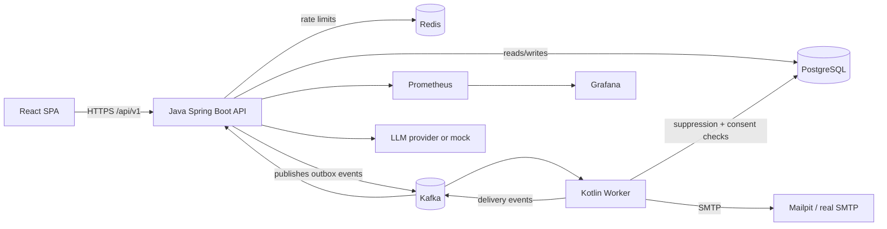

# MailScale

MailScale is a multi-tenant email communication platform for sending transactional and marketing email.
It is a portfolio-style engineering project demonstrating the competencies expected of a Software
Engineer on a large-scale messaging platform (in the style of Infobip's email product).

> **Honesty note:** MailScale is a modular monolith API plus a separately deployable Kotlin worker.
> It is *not* a globally distributed, billion-message-per-day system. All performance numbers in
> `docs/benchmarks/` are measured locally and clearly labeled with the machine, dataset, and
> configuration used. Nothing here claims production readiness beyond what is demonstrated.

## Feature overview

- Multi-tenant organizations with RBAC (`OWNER`, `ADMIN`, `MARKETER`, `VIEWER`) and JWT auth
- Contact management: CSV import with validation, duplicate detection, tags, segments, consent tracking
- Email templates with versioning and safe `{{variable}}` substitution
- Versioned transactional email API (`POST /api/v1/emails`) with idempotency, rate limiting, and async queueing
- Marketing campaigns with scheduling, segment selection, consent/suppression checks, pause/cancel
- Reliable async processing: transactional outbox -> Kafka -> Kotlin worker -> SMTP adapter -> delivery events
- Retry with exponential backoff + jitter, dead-letter topic, transient vs permanent failure classification
- Suppression lists and unsubscribe enforcement
- AI assistant (OpenAI-compatible adapter, structured output, mock mode for offline demos)
- Observability: Spring Actuator, Micrometer/Prometheus, Grafana, structured logs, correlation IDs
- PostgreSQL (default), documented SQL Server compatibility profile, Redis for rate limiting

## Architecture (high level)



Component boundaries, failure handling, and data flow are documented in
[docs/architecture/overview.md](docs/architecture/overview.md).

## Technology stack

| Layer | Technology |
| --- | --- |
| API | Java 21, Spring Boot 3.5, Spring Web, Spring Security, Spring Data JPA, Hibernate, Flyway, Springdoc |
| Worker | Kotlin 2.1, Gradle, kafka-clients, kotlinx.coroutines, HikariCP, JavaMail |
| Frontend | React 19, TypeScript, Vite, Tailwind CSS, React Router, TanStack Query, React Hook Form, Zod, Recharts |
| Messaging | Apache Kafka (KRaft), transactional outbox |
| Data | PostgreSQL 16 (default), Redis 7, SQL Server compatibility profile |
| Email | SMTP adapter with pluggable providers (Mailpit locally, mock in tests) |
| AI | OpenAI-compatible REST adapter with structured output + mock provider |
| Observability | Actuator, Micrometer, Prometheus, Grafana, OpenTelemetry-ready logging |
| Quality | JUnit 5, Mockito, Testcontainers, Vitest, React Testing Library, Playwright, k6, Checkstyle, SpotBugs, Detekt |

## Prerequisites

- JDK 21+ (the project builds with JDK 21; CI uses Temurin 21/25)
- Node.js 20+ / npm 10+
- Docker + Docker Compose (for PostgreSQL, Kafka, Redis, Mailpit, Prometheus, Grafana)
- Maven 3.9+ (or use the wrapper), Gradle 8.14+ (or use the wrapper)

## Quick start

```bash
cp .env.example .env
docker compose up --build -d        # postgres, kafka, redis, mailpit, prometheus, grafana
./mvnw -f backend-java/pom.xml spring-boot:run   # API on :8080
./gradlew -p worker-kotlin run                 # worker (consumes Kafka)
npm --prefix frontend install && npm --prefix frontend run dev   # SPA on :5173
```

See [docs/DEVELOPMENT.md](docs/DEVELOPMENT.md) for the full local setup, seed data, and
troubleshooting. The API exposes OpenAPI docs at <http://localhost:8080/swagger-ui.html> and
health at <http://localhost:8080/actuator/health>.

## Documentation index

- [Architecture overview](docs/architecture/overview.md) — components, boundaries, data flow, failure handling
- [ADRs](docs/adr/) — 8 architecture decision records
- [Database schema](docs/database/schema.md)
- [Kafka topic design](docs/architecture/kafka.md)
- [API reference](docs/api/openapi.md)
- [Testing guide](docs/testing/README.md)
- [Benchmarks](docs/benchmarks/README.md) — measured results only, with machine/config context
- [Development guide](docs/DEVELOPMENT.md)

## Repository layout

```
mailscale/
├── frontend/              # React + TypeScript SPA (Vite)
├── backend-java/          # Spring Boot API (Maven)
├── worker-kotlin/         # Email processing worker (Gradle, Kotlin)
├── infrastructure/        # docker, kafka, prometheus, grafana config
├── load-tests/            # k6 scenarios
├── e2e-tests/             # Playwright end-to-end tests
├── docs/                  # architecture, adr, database, api, testing, benchmarks
├── scripts/               # helper scripts
├── .github/workflows/     # CI pipelines
├── docker-compose.yml
├── .env.example
└── Makefile
```

## Security

- Passwords hashed with BCrypt; JWT access tokens (short-lived) with HS256/RS256 configuration
- Tenant isolation enforced server-side: every request resolves the caller's organization and
  membership; client-supplied tenant IDs are never trusted
- API keys stored as SHA-256 hashes with rotation support
- Rate limiting on the transactional email endpoint (Redis-backed sliding window)
- HTML sanitization on templates; no PI/email bodies in logs; secrets via environment variables

## License

MIT — demonstration project. No real credentials or recipient datasets are committed.
