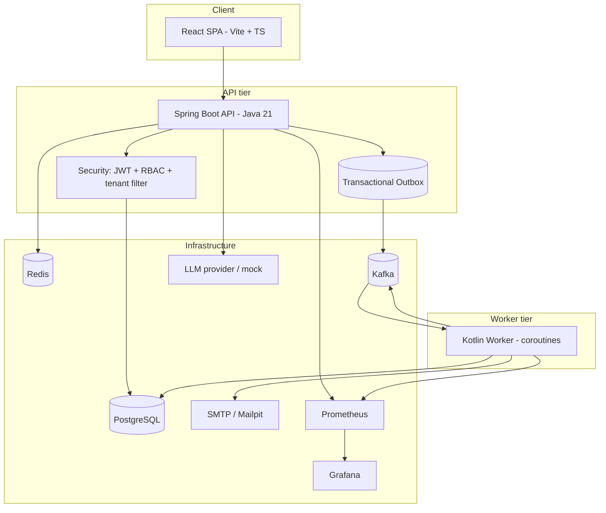
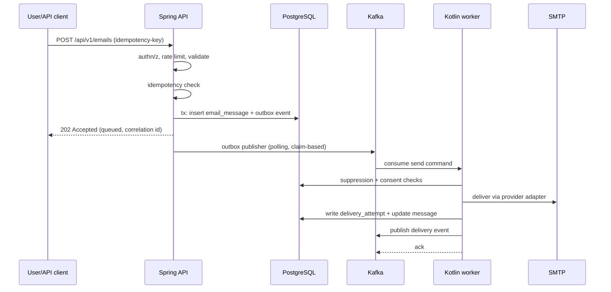

# MailScale Architecture Overview

## Component map

## Request flow (transactional email)

## Boundaries and responsibilities

| Component | Owns | Does not own |
| --- | --- | --- |
| React SPA | UI state, routing, forms | business rules; all authorization decisions |
| Spring API | REST contracts, authn/z, validation, outbox writes, analytics reads | direct SMTP delivery |
| Outbox | reliable hand-off of domain events to Kafka | business logic |
| Kafka | durable transport, ordering per key, replay | exactly-once external delivery |
| Kotlin worker | delivery execution, retry/backoff, suppression checks | authorization, API contracts |
| Provider adapters (SMTP/mock) | transport to an email provider | routing decisions |

## Failure handling

1. **API crash after DB commit, before Kafka publish**: the outbox publisher replays
   unpublished events after restart (at-least-once).
2. **Worker crash mid-delivery**: the Kafka offset is committed only after the delivery
   attempt is durably recorded; on restart the message is reprocessed. The provider
   adapter is idempotency-aware (message key = deterministic idempotency key) so a
   repeat delivery is detectable at the provider where supported.
3. **Transient SMTP failure**: retried with exponential backoff + jitter, up to
   `MAIL_MAX_DELIVERY_ATTEMPTS`; then dead-lettered.
4. **Permanent failure (invalid recipient)**: no retry; message marked `FAILED` with an
   error code.
5. **Suppressed/unsubscribed recipient**: delivery is skipped before any SMTP call.

## Delivery guarantees

The pipeline is **at-least-once** from the API to the worker. External SMTP delivery is
best-effort: a provider may accept a message while the worker loses the acknowledgment,
producing a possible duplicate send. We do **not** promise exactly-once email delivery;
we minimize duplicates via deterministic idempotency keys and provider-side dedup where
supported, and we detect duplicates in delivery status updates.

## Concurrency model

| Mechanism | Where | Why |
| --- | --- | --- |
| Tomcat bounded thread pool | API | HTTP serving, bounded connections |
| HikariCP bounded pool (20) | API + worker | DB connection cap |
| Kafka consumer `max.poll.records` + fixed coroutine dispatcher | Worker | bounded parallelism, no unbounded thread creation |
| Scheduled outbox publisher (single-threaded) | API | one publisher loop per instance |
| Redis sliding-window counters | API | rate limiting across instances |

See [kafka.md](kafka.md) for topic design and [../adr/](adr/) for the decisions behind
these choices.
